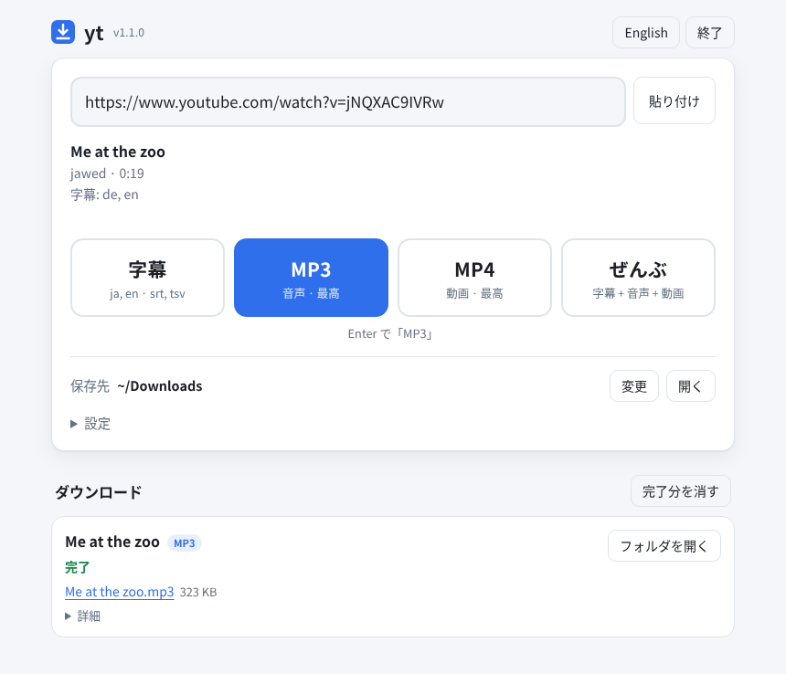

<!-- i18n: language-switcher -->
[English](README.md) | [日本語](README.ja.md)

# YouTube Tools

YouTube の字幕・MP3・MP4 を、URL を貼ってボタンを1つ押すだけで取得するツールです。

コマンドを覚える必要はありません。`yt` を起動すると、自分のパソコンの中で動く画面がブラウザに開きます。
`duckdb -ui` と同じ考え方で、画面は入口にすぎず、裏側では同じ `yt` が処理します。



最終確認日: 2026-11-27

## インストール

ファイル1つです。Python は不要で、ffmpeg を自分で入れる必要もありません。

Linux / macOS:

```bash
curl -fsSL https://raw.githubusercontent.com/hjosugi/youtube-tools/main/install.sh | sh
```

Windows (PowerShell):

```powershell
irm https://raw.githubusercontent.com/hjosugi/youtube-tools/main/install.ps1 | iex
```

同じ行をもう一度実行すると更新できます。
[Releases](https://github.com/hjosugi/youtube-tools/releases) から環境に合うバイナリを直接取ることもできます。

## 使い方

1. `yt` を起動します。ターミナルで `yt` と打つか、Linux と Windows ではインストーラーが
   アプリ一覧に追加する **yt** を選びます。
2. YouTube の URL を貼り付けます。
3. **字幕**・**MP3**・**MP4**・**ぜんぶ** のどれかを押します。

ファイルはダウンロードフォルダに保存され、終わったものから画面に並びます。

- **Enter** は最後に押したボタンと同じ動作です。次の動画は「貼り付けて Enter」で済みます。
- 複数の URL は改行で区切ります。プレイリストの URL を貼ると中の動画を1本ずつ取得します。
- 保存先・字幕の言語・画質・ファイルの種類は **設定** にあり、変更はその場で保存されます。
- MP3 と MP4 には ffmpeg が必要です。パソコンに無ければ、最初に必要になったときに `yt` が自分用のものをダウンロードします。
- 画面は `127.0.0.1` でのみ公開され、`yt` が開いたタブからしか操作できません。

## 短いコマンドでも

ボタンと同じ言葉で指定できます。

```bash
yt mp3 URL                 # 音声を MP3 で
yt mp4 URL                 # 動画を MP4 で
yt sub URL                 # 字幕
yt all URL                 # 3つとも
yt sub URL -l en,ja        # 英語と日本語の字幕
yt mp4 URL --vq 1080       # 動画を 1080p までに制限
```

すべてのオプションは [`apps/yt/README.ja.md`](apps/yt/README.ja.md) にあります。

## 更新は自動です

YouTube は頻繁に変わり、ダウンロードを担う `yt-dlp` がそれに追従します。
このリポジトリは、誰も手を動かさずに `yt-dlp` に追従します。

1. [Dependabot](.github/dependabot.yml) が毎日依存関係を確認し、プルリクエストを作ります。
2. CI が Linux / macOS / Windows でテストし、バイナリをビルドします。
3. すべて通ればプルリクエストは自動でマージされます。
4. バイナリに含まれるものが変わった場合はパッチリリースを作り、5つのプラットフォーム向けのバイナリを公開します。

新しい版を使うには、インストールの行をもう一度実行します。

## リポジトリ構成

```text
apps/
  yt/            本体: CLI・Web UI・テスト・ビルドスクリプト・シェル補完
docs/
  consolidation.ja.md
scripts/
  bump-version.py
install.sh       Linux / macOS 用の1行インストーラー
install.ps1      Windows 用の1行インストーラー
.github/
  dependabot.yml 毎日の依存関係更新
  workflows/
    ci.yml       lint・テスト・試験ビルド。Dependabot の更新をマージしてリリースする
    release.yml  v* タグごとにバイナリをビルドして公開する
```

## これまでの経緯

もとは4つの別々の YouTube ユーティリティで、その後デスクトップウィンドウ付きの1つのコマンドになりました。
統合・削除・変更の内容は [`docs/consolidation.ja.md`](docs/consolidation.ja.md) を参照してください。

## 安全性と利用範囲

- アクセスと処理が許可されているコンテンツにのみ使用してください。
- YouTube の利用規約・著作権・レート制限・投稿者の許諾を尊重してください。
- ダウンロードしたメディア・字幕・API キー・Cookie・ブラウザプロファイルはコミットしないでください。
- 必要時にダウンロードされる ffmpeg は、[imageio-ffmpeg](https://github.com/imageio/imageio-ffmpeg)
  プロジェクトが PyPI で配布している静的ビルドです。GPL ライセンスのソフトウェアを利用者のパソコンへ取得するもので、
  このリポジトリにも配布バイナリにも含まれていません。

## ライセンス

0BSD。ほぼ任意の目的で利用・複製・改変・配布できます。
