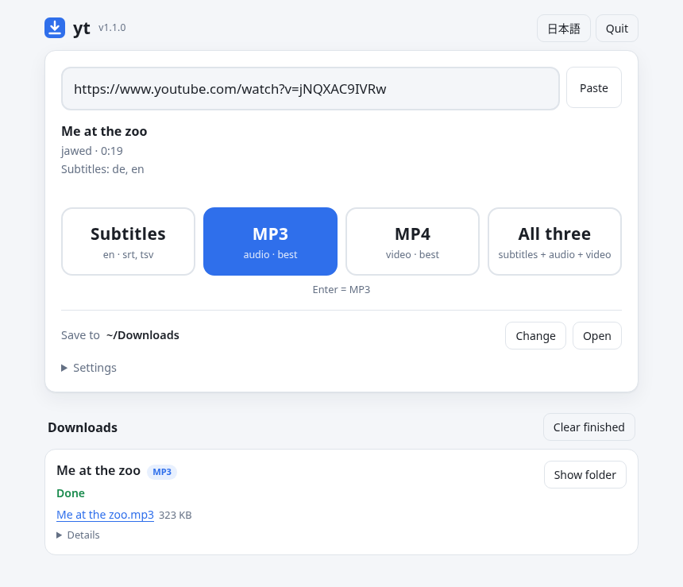

<!-- i18n: language-switcher -->
[English](README.md) | [日本語](README.ja.md)

# YouTube Tools

Get the subtitles, the MP3 or the MP4 of a YouTube video: paste the URL, press one button.

There are no commands to remember. Start `yt` and a page opens in your browser, served from
your own machine. It works the way `duckdb -ui` does: the page is only the front, and the
same `yt` program does the work behind it.



Last verified: 2026-11-27

## Install

One file. You do not need Python, and you do not need to install ffmpeg.

Linux and macOS:

```bash
curl -fsSL https://raw.githubusercontent.com/hjosugi/youtube-tools/main/install.sh | sh
```

Windows (PowerShell):

```powershell
irm https://raw.githubusercontent.com/hjosugi/youtube-tools/main/install.ps1 | iex
```

Run the same line again to update. You can also take the binary for your platform straight
from [Releases](https://github.com/hjosugi/youtube-tools/releases).

## Use

1. Start `yt`. From a terminal type `yt`; on Linux and Windows the installer also adds a
   **yt** entry to the application menu.
2. Paste a YouTube URL.
3. Press **Subtitles**, **MP3**, **MP4** or **All three**.

The files land in your Downloads folder, and the page shows them as they finish.

- **Enter** repeats the button you pressed last, so the next video is: paste, Enter.
- Several URLs go on separate lines. A playlist URL downloads every video in it.
- The folder, subtitle languages, quality and file types are under **Settings** and are
  saved as you change them.
- MP3 and MP4 need ffmpeg. If your machine has none, `yt` downloads its own copy the first
  time it is needed.
- The page is served on `127.0.0.1` only, and only the tab that `yt` opened can use it.

## Or one short command

The words are the same as the buttons:

```bash
yt mp3 URL                 # audio as MP3
yt mp4 URL                 # video as MP4
yt sub URL                 # subtitles
yt all URL                 # all three
yt sub URL -l en,ja        # English and Japanese subtitles
yt mp4 URL --vq 1080       # video capped at 1080p
```

The one-letter forms are `yt a URL` for audio, `yt v URL` for video and `yt s URL` for subtitles. Combine them as `yt av URL` for audio and video. [Enable Tab completion in Bash, Zsh, fish or PowerShell](apps/yt/README.md#shell-completion).

Every option is in [`apps/yt/README.md`](apps/yt/README.md).

## It keeps itself up to date

YouTube changes often, and `yt-dlp`, which does the downloading, follows it. This repository
follows `yt-dlp` without anyone having to act:

1. [Dependabot](.github/dependabot.yml) checks the dependencies every day and opens a pull request.
2. CI tests it on Linux, macOS and Windows and builds a binary.
3. When everything is green the pull request merges itself.
4. If the update changes anything that ships inside the binary, a patch release is cut and
   the binaries for five platforms are published.

To get the new version, run the install line again.

## Repository layout

```text
apps/
  yt/            the tool: CLI, web UI, tests, build script, shell completions
docs/
  consolidation.md
scripts/
  bump-version.py
install.sh       one-line installer for Linux and macOS
install.ps1      one-line installer for Windows
.github/
  dependabot.yml daily dependency updates
  workflows/
    ci.yml       lint, tests, a test build; merges Dependabot updates and releases them
    release.yml  builds and publishes the binaries for every v* tag
```

## History

This used to be four separate YouTube utilities, then one command with a desktop window.
[`docs/consolidation.md`](docs/consolidation.md) records what was merged, dropped and changed.

## Safety and scope

- Use this only for content you are allowed to access and process.
- Respect YouTube's terms, copyright, rate limits and creator permissions.
- Do not commit downloaded media, subtitles, API keys, cookies or browser profiles.
- The ffmpeg that is downloaded on demand is the static build the
  [imageio-ffmpeg](https://github.com/imageio/imageio-ffmpeg) project publishes on PyPI.
  It is GPL-licensed software fetched to your machine; it is not part of this repository
  or of its binaries.

## License

0BSD. You may use, copy, modify and distribute this software for almost any purpose.
